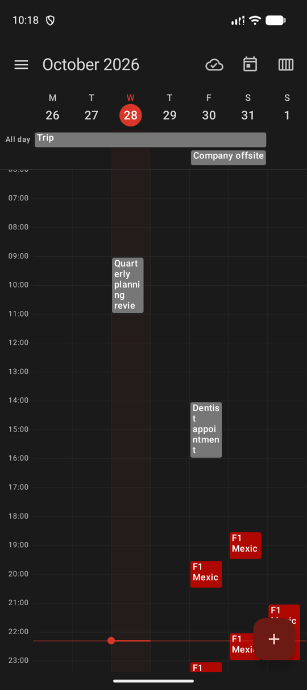
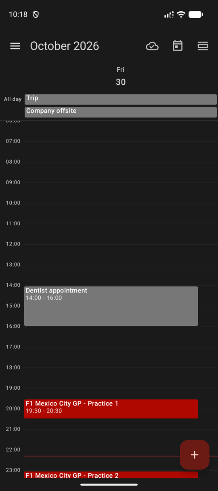
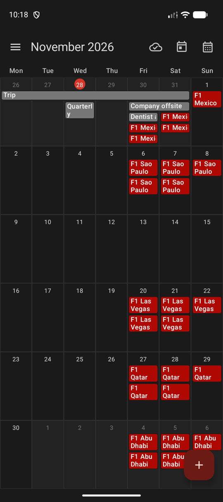
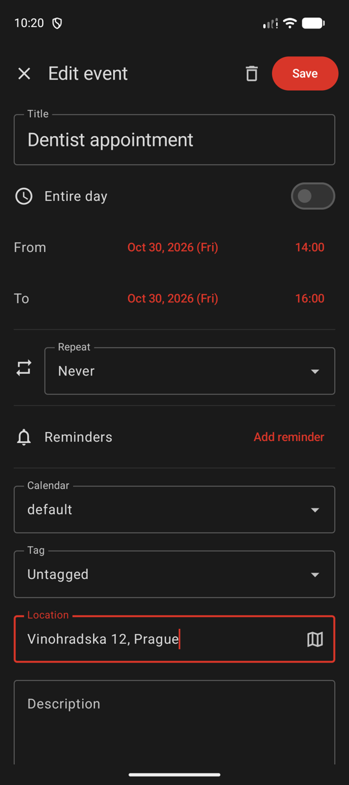
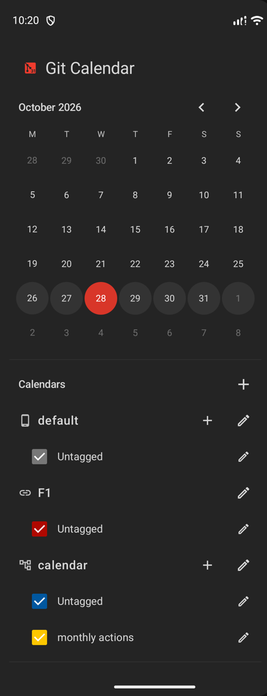

# Git Calendar for Android

A native Android client for [Git Calendar](https://github.com/git-calendar): calendars stored in Git repositories. Built with Kotlin and Jetpack Compose (Material 3).

> [!NOTE]
> This app is 100% generated by AI, use with caution  
> Checkout the [Calendar Core](https://github.com/git-calendar/core) which does the hard job in this application

| Week | Day | Month | Event | Calendars |
|:---:|:---:|:---:|:---:|:---:|
|  |  |  |  |  |

## Features

- Git calendars: create, clone, sync with a remote, optional encryption
- iCal feed subscriptions and `.ics` import, ZIP / ICS export, ZIP restore
- Tags, repeating events, reminders and background sync
- _other standart calendar features..._

## Core

The calendar logic is the shared Go core of Git Calendar, bound to Android with gomobile. The app builds against [jotalac/git-calendar-core](https://github.com/jotalac/git-calendar-core), a fork of [git-calendar/core](https://github.com/git-calendar/core) that adds the `pkg/mobile` binding.

## Build

The core must be checked out next to this repository:

```
git-calendar/
├── git-calendar-core/      # https://github.com/jotalac/git-calendar-core
└── git-calendar-android/   # this repository
```

```bash
git clone https://github.com/jotalac/git-calendar-core.git
git clone https://github.com/jotalac/git-calendar-android.git
cd git-calendar-android
./gradlew installDebug
```

Requirements: Android Studio (Android SDK with the NDK) and Go 1.27 or newer. Gradle builds the core into `app/libs/core.aar` with `make core` automatically when the core changes. If `go` is not found, set `go.path=/path/to/go` in `local.properties`.

Unit tests: `./gradlew test`. The app needs Android 12 (API 31) or newer.
